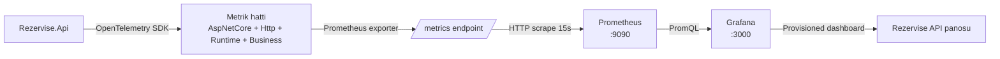

# Metrik Izleme (OpenTelemetry ? Prometheus ? Grafana)

Rezervise.Api, uygulama ve is metriklerini **OpenTelemetry** ile toplar, **Prometheus** ile kazir
ve **Grafana** ile görsellestirir. Local gelistirme için tam yigin `docker compose` ile ayaga kalkar.

## 1. Mimari



Bilesenler:

| Bilesen | Sorumluluk |
|---|---|
| `Rezervise.Api\Metrics\MetricsServiceCollectionExtensions.cs` | OpenTelemetry hattini kurar; hata durumunda uygulamayi **durdurmaz** |
| `Rezervise.Application\Common\Diagnostics\RezerviseMetrics.cs` | Is metriklerinin tek kaynagi (`Meter` + sayaçlar) |
| `ops\prometheus\prometheus.yml` | Scrape hedefi ve araligi |
| `ops\grafana\provisioning\` | Datasource + dashboard otomatik yükleme |
| `ops\grafana\dashboards\Rezervise-api.json` | 14 panelli hazir pano |

## 2. Toplanan metrikler

### HTTP ve runtime

| Prometheus adi | Tip | Etiketler | Anlam |
|---|---|---|---|
| `http_server_request_duration_seconds_count` | counter | `http_route`, `http_method`, `http_response_status_code` | Istek sayisi |
| `http_server_request_duration_seconds_bucket` | histogram | `le`, `http_route` | Süre dagilimi (p95/p99 için) |
| `process_runtime_dotnet_gc_heap_size_bytes` | gauge | `gc_heap_size` | Yönetilen heap boyutu |
| `process_runtime_dotnet_thread_pool_queue_length` | gauge | — | Thread pool kuyrugu (starvation göstergesi) |
| `process_runtime_dotnet_exceptions_total` | counter | `exception_type` | Yakalanan istisnalar |
| `db_client_operation_duration_seconds_*` | histogram | `db_operation_name` | EF Core sorgu süreleri (`Metrics:IncludeEfCoreInstrumentation`) |

### Is metrikleri

| Prometheus adi | Etiketler | Anlam |
|---|---|---|
| `Rezervise_appointments_created_total` | — | Gerçekten olusturulan randevu (idempotent tekrar sayilmaz) |
| `Rezervise_appointments_confirmed_total` | — | Isletme sahibi tarafindan onaylanan |
| `Rezervise_appointments_cancelled_total` | — | Iptal edilen |
| `Rezervise_appointments_completed_total` | — | Tamamlanan |
| `Rezervise_appointments_rescheduled_total` | — | Yeniden planlanan |
| `Rezervise_users_registered_total` | `role` | Self-servis kayitlar |
| `Rezervise_auth_login_attempts_total` | `result` (`success` / `invalid_credentials` / `locked`) | Giris denemeleri |
| `Rezervise_auth_refresh_rotations_total` | `outcome` (`success` / `reused` / `invalid` / `expired`) | Refresh token rotasyonlari |

> **Kardinalite uyarisi:** Etiketler bilinçli olarak düsük kardinalitede tutulur. `userId`,
> `businessId`, `appointmentId`, `email`, `correlationId` gibi degerler **asla** etiket olarak
> eklenmemelidir — her yeni deger ayri bir zaman serisi üretir ve Prometheus'u bogar.

`reused` sayaci sifirdan büyükse bir refresh token ikinci kez sunulmustur; sistem o kullanicinin
tüm oturumlarini iptal eder. Bu, güvenlik açisindan **alarm verilmesi gereken** bir durumdur.

## 3. Erisim

Local yigin:

```powershell
docker compose up -d --build
```

| Servis | Adres | Not |
|---|---|---|
| Grafana | http://localhost:3000 | Kullanici `admin`, parola `GRAFANA_ADMIN_PASSWORD` (.env) |
| Prometheus | http://localhost:9090 | `Status ? Targets` bölümünde `Rezervise-api` **UP** olmali |
| Ham metrikler | http://localhost:8080/metrics | Host 8080 ? container 8082 |

Dashboard ilk açilista `Rezervise` klasörü altinda otomatik yüklenir.

## 4. PromQL örnekleri

```promql
# Saniyedeki toplam istek
sum(rate(http_server_request_duration_seconds_count[5m]))

# Route bazinda p95 gecikme
histogram_quantile(0.95, sum(rate(http_server_request_duration_seconds_bucket[5m])) by (le, http_route))

# 5xx orani (%)
100 * sum(rate(http_server_request_duration_seconds_count{http_response_status_code=~"5.."}[5m]))
    / clamp_min(sum(rate(http_server_request_duration_seconds_count[5m])), 0.0001)

# Dakikada olusturulan randevu
sum(rate(Rezervise_appointments_created_total[5m])) * 60

# Son 15 dakikadaki basarisiz giris sayisi
sum(increase(Rezervise_auth_login_attempts_total{result="invalid_credentials"}[15m]))

# Refresh token yeniden kullanimi (güvenlik alarmi)
sum(increase(Rezervise_auth_refresh_rotations_total{outcome="reused"}[15m]))

# Thread pool kuyrugu
process_runtime_dotnet_thread_pool_queue_length
```

## 5. Üretim notlari

1. **`/metrics` ucunu ag seviyesinde kisitlayin.** Endpoint `AllowAnonymous` olarak eslenir çünkü
   Prometheus kimlik dogrulamasi yapmaz. Canlida reverse proxy / firewall ile yalnizca Prometheus
   sunucusunun IP'sine izin verin veya iç agda tutun. Genel internete açik birakmayin.
2. **HTTPS yönlendirmesi.** `UseHttpsRedirection` aktifse ve HTTPS portu tanimliysa, HTTP üzerinden
   yapilan scrape istegi `307` döner ve Prometheus metrik toplayamaz. Bu durumda ya scrape'i HTTPS'e
   tasiyin ya da container'da `ASPNETCORE_HTTPS_PORTS` tanimlamayin (yönlendirme devre disi kalir).
3. **Saklama süresi.** Prometheus `--storage.tsdb.retention.time=15d` ile çalisir. Uzun vadeli saklama
   gerekiyorsa Thanos / Cortex / VictoriaMetrics gibi bir uzun dönem depoya geçin.
4. **Scrape araligi.** 15 sn. Daha sik aralik, seri sayisiyla çarpilarak disk ve CPU maliyetini artirir.
5. **Grafana güvenligi.** Anonim erisim ve kayit kapalidir. Admin parolasi `.env` üzerinden gelir;
   canlida bir secret store kullanin.
6. **Kardinalite izleme.** Yeni bir metrik eklerken etiket kümesini sinirli tutun; Prometheus'ta
   `scrape_samples_scraped` degerindeki ani artis kardinalite patlamasinin isaretidir.

## 6. Devre disi birakma

`appsettings.json` (veya ortam degiskenleri) üzerinden kapatilabilir:

```json
"Metrics": {
  "Enabled": false
}
```

`Enabled = false` iken OpenTelemetry hatti **hiç kaydedilmez** ve `/metrics` endpoint'i eslenmez;
süreç üzerinde ek yük olusmaz.

EF Core metriklerini ayrica kapatmak için `IncludeEfCoreInstrumentation: false`.
Endpoint yolunu degistirmek için `EndpointPath` (rate limiter muafiyeti de bu degeri okur).

## 7. Dogrulama

```powershell
# 1) Uygulama ayakta mi, metrik üretiyor mu?
curl.exe -s http://localhost:8080/metrics | Select-String "Rezervise_"

# 2) Prometheus hedefi UP mu?
#    http://localhost:9090/targets  -> job "Rezervise-api" state=UP

# 3) Anlik sorgu
#    http://localhost:9090/graph  -> sum(rate(http_server_request_duration_seconds_count[5m]))

# 4) Grafana panosu yüklendi mi?
#    http://localhost:3000 -> Dashboards -> Rezervise -> "Rezervise API"
```

Beklenen: `/metrics` çiktisinda `Rezervise_appointments_created_total`, `Rezervise_auth_login_attempts_total`
gibi seriler görünür. Is metrikleri yalnizca ilgili islem gerçeklestikten sonra olusur (ör. bir randevu
olusturulmadan sayaç görünmez).

## 8. Kapsam disi

- **Tracing (OpenTelemetry Traces)** ve OTLP exporter — bu çalismada yalnizca metrik hedeflendi.
- **Alertmanager / uyari kurallari** — istenmedi. Yukaridaki PromQL örnekleri kural yazimi için baslangiç noktasidir.
- **Uzun dönem metrik depolama** (Thanos vb.).
