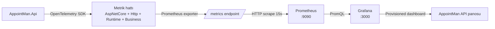

# Metrik İzleme (OpenTelemetry → Prometheus → Grafana)

AppointMan.Api, uygulama ve iş metriklerini **OpenTelemetry** ile toplar, **Prometheus** ile kazır
ve **Grafana** ile görselleştirir. Local geliştirme için tam yığın `docker compose` ile ayağa kalkar.

## 1. Mimari



Bileşenler:

| Bileşen | Sorumluluk |
|---|---|
| `AppointMan.Api\Metrics\MetricsServiceCollectionExtensions.cs` | OpenTelemetry hattını kurar; hata durumunda uygulamayı **durdurmaz** |
| `AppointMan.Application\Common\Diagnostics\AppointManMetrics.cs` | İş metriklerinin tek kaynağı (`Meter` + sayaçlar) |
| `ops\prometheus\prometheus.yml` | Scrape hedefi ve aralığı |
| `ops\grafana\provisioning\` | Datasource + dashboard otomatik yükleme |
| `ops\grafana\dashboards\appointman-api.json` | 14 panelli hazır pano |

## 2. Toplanan metrikler

### HTTP ve runtime

| Prometheus adı | Tip | Etiketler | Anlam |
|---|---|---|---|
| `http_server_request_duration_seconds_count` | counter | `http_route`, `http_method`, `http_response_status_code` | İstek sayısı |
| `http_server_request_duration_seconds_bucket` | histogram | `le`, `http_route` | Süre dağılımı (p95/p99 için) |
| `process_runtime_dotnet_gc_heap_size_bytes` | gauge | `gc_heap_size` | Yönetilen heap boyutu |
| `process_runtime_dotnet_thread_pool_queue_length` | gauge | — | Thread pool kuyruğu (starvation göstergesi) |
| `process_runtime_dotnet_exceptions_total` | counter | `exception_type` | Yakalanan istisnalar |
| `db_client_operation_duration_seconds_*` | histogram | `db_operation_name` | EF Core sorgu süreleri (`Metrics:IncludeEfCoreInstrumentation`) |

### İş metrikleri

| Prometheus adı | Etiketler | Anlam |
|---|---|---|
| `appointman_appointments_created_total` | — | Gerçekten oluşturulan randevu (idempotent tekrar sayılmaz) |
| `appointman_appointments_confirmed_total` | — | İşletme sahibi tarafından onaylanan |
| `appointman_appointments_cancelled_total` | — | İptal edilen |
| `appointman_appointments_completed_total` | — | Tamamlanan |
| `appointman_appointments_rescheduled_total` | — | Yeniden planlanan |
| `appointman_users_registered_total` | `role` | Self-servis kayıtlar |
| `appointman_auth_login_attempts_total` | `result` (`success` / `invalid_credentials` / `locked`) | Giriş denemeleri |
| `appointman_auth_refresh_rotations_total` | `outcome` (`success` / `reused` / `invalid` / `expired`) | Refresh token rotasyonları |

> **Kardinalite uyarısı:** Etiketler bilinçli olarak düşük kardinalitede tutulur. `userId`,
> `businessId`, `appointmentId`, `email`, `correlationId` gibi değerler **asla** etiket olarak
> eklenmemelidir — her yeni değer ayrı bir zaman serisi üretir ve Prometheus'u boğar.

`reused` sayacı sıfırdan büyükse bir refresh token ikinci kez sunulmuştur; sistem o kullanıcının
tüm oturumlarını iptal eder. Bu, güvenlik açısından **alarm verilmesi gereken** bir durumdur.

## 3. Erişim

Local yığın:

```powershell
docker compose up -d --build
```

| Servis | Adres | Not |
|---|---|---|
| Grafana | http://localhost:3000 | Kullanıcı `admin`, parola `GRAFANA_ADMIN_PASSWORD` (.env) |
| Prometheus | http://localhost:9090 | `Status → Targets` bölümünde `appointman-api` **UP** olmalı |
| Ham metrikler | http://localhost:8080/metrics | Host 8080 → container 8082 |

Dashboard ilk açılışta `AppointMan` klasörü altında otomatik yüklenir.

## 4. PromQL örnekleri

```promql
# Saniyedeki toplam istek
sum(rate(http_server_request_duration_seconds_count[5m]))

# Route bazında p95 gecikme
histogram_quantile(0.95, sum(rate(http_server_request_duration_seconds_bucket[5m])) by (le, http_route))

# 5xx oranı (%)
100 * sum(rate(http_server_request_duration_seconds_count{http_response_status_code=~"5.."}[5m]))
    / clamp_min(sum(rate(http_server_request_duration_seconds_count[5m])), 0.0001)

# Dakikada oluşturulan randevu
sum(rate(appointman_appointments_created_total[5m])) * 60

# Son 15 dakikadaki başarısız giriş sayısı
sum(increase(appointman_auth_login_attempts_total{result="invalid_credentials"}[15m]))

# Refresh token yeniden kullanımı (güvenlik alarmı)
sum(increase(appointman_auth_refresh_rotations_total{outcome="reused"}[15m]))

# Thread pool kuyruğu
process_runtime_dotnet_thread_pool_queue_length
```

## 5. Üretim notları

1. **`/metrics` ucunu ağ seviyesinde kısıtlayın.** Endpoint `AllowAnonymous` olarak eşlenir çünkü
   Prometheus kimlik doğrulaması yapmaz. Canlıda reverse proxy / firewall ile yalnızca Prometheus
   sunucusunun IP'sine izin verin veya iç ağda tutun. Genel internete açık bırakmayın.
2. **HTTPS yönlendirmesi.** `UseHttpsRedirection` aktifse ve HTTPS portu tanımlıysa, HTTP üzerinden
   yapılan scrape isteği `307` döner ve Prometheus metrik toplayamaz. Bu durumda ya scrape'i HTTPS'e
   taşıyın ya da container'da `ASPNETCORE_HTTPS_PORTS` tanımlamayın (yönlendirme devre dışı kalır).
3. **Saklama süresi.** Prometheus `--storage.tsdb.retention.time=15d` ile çalışır. Uzun vadeli saklama
   gerekiyorsa Thanos / Cortex / VictoriaMetrics gibi bir uzun dönem depoya geçin.
4. **Scrape aralığı.** 15 sn. Daha sık aralık, seri sayısıyla çarpılarak disk ve CPU maliyetini artırır.
5. **Grafana güvenliği.** Anonim erişim ve kayıt kapalıdır. Admin parolası `.env` üzerinden gelir;
   canlıda bir secret store kullanın.
6. **Kardinalite izleme.** Yeni bir metrik eklerken etiket kümesini sınırlı tutun; Prometheus'ta
   `scrape_samples_scraped` değerindeki ani artış kardinalite patlamasının işaretidir.

## 6. Devre dışı bırakma

`appsettings.json` (veya ortam değişkenleri) üzerinden kapatılabilir:

```json
"Metrics": {
  "Enabled": false
}
```

`Enabled = false` iken OpenTelemetry hattı **hiç kaydedilmez** ve `/metrics` endpoint'i eşlenmez;
süreç üzerinde ek yük oluşmaz.

EF Core metriklerini ayrıca kapatmak için `IncludeEfCoreInstrumentation: false`.
Endpoint yolunu değiştirmek için `EndpointPath` (rate limiter muafiyeti de bu değeri okur).

## 7. Doğrulama

```powershell
# 1) Uygulama ayakta mı, metrik üretiyor mu?
curl.exe -s http://localhost:8080/metrics | Select-String "appointman_"

# 2) Prometheus hedefi UP mu?
#    http://localhost:9090/targets  -> job "appointman-api" state=UP

# 3) Anlık sorgu
#    http://localhost:9090/graph  -> sum(rate(http_server_request_duration_seconds_count[5m]))

# 4) Grafana panosu yüklendi mi?
#    http://localhost:3000 -> Dashboards -> AppointMan -> "AppointMan API"
```

Beklenen: `/metrics` çıktısında `appointman_appointments_created_total`, `appointman_auth_login_attempts_total`
gibi seriler görünür. İş metrikleri yalnızca ilgili işlem gerçekleştikten sonra oluşur (ör. bir randevu
oluşturulmadan sayaç görünmez).

## 8. Kapsam dışı

- **Tracing (OpenTelemetry Traces)** ve OTLP exporter — bu çalışmada yalnızca metrik hedeflendi.
- **Alertmanager / uyarı kuralları** — istenmedi. Yukarıdaki PromQL örnekleri kural yazımı için başlangıç noktasıdır.
- **Uzun dönem metrik depolama** (Thanos vb.).
